# Harness Engineering — Design & Flows

> Tài liệu sơ đồ hóa đi kèm khóa học **harness-engineering-course.html** (43 mục) và handbook gốc *"Understanding Harness Engineering"* của @techNmak.
> Để xem sơ đồ đã vẽ sẵn đẹp mắt: mở **design.html** (cùng thư mục) trên trình duyệt. Nếu xem file Markdown này trên GitHub / VS Code (có extension Mermaid) / Obsidian / Typora, các khối sơ đồ sẽ tự vẽ.

## 0 · Cách đọc tài liệu này

- Mỗi phần có cấu trúc: **vài câu giải thích → sơ đồ → 🔑 ý chính**. Đọc theo chiều mũi tên.
- Quy ước trong sơ đồ:
  - Mũi tên liền = luồng chính; mũi tên nét đứt = luồng phụ / cảnh báo / ràng buộc.
  - Chữ nhật = bước hoặc hệ thống; hình thoi = điểm quyết định; hình tròn đầu mút = bắt đầu / kết thúc.
- Từ khóa xuyên suốt cần nằm lòng: **control plane** (bộ điều khiển — harness) khác **execution plane** (nơi thực thi — sandbox), và **durable state** (bền vững) khác **active context** (nhìn thấy ngay lúc này).
- Những mục đánh số trong ngoặc, ví dụ *(Mục 7)*, là mục tương ứng trong khóa học để tra cứu sâu hơn.

## 1 · Toàn cảnh — ba khối của một hệ agent

Một lần gọi model chỉ là `y ~ p(c)`. Muốn thành agent, phải có ba khối: **model** (năng lực đã học), **harness** (bộ điều khiển nối năng lực vào hành động, lặp theo thời gian) và **environment** (nơi hành động thực sự xảy ra). Harness giữ một "bộ nhớ bền" — durable session — tách biệt với những gì model nhìn thấy trong từng lượt. *(Mục 1–4)*

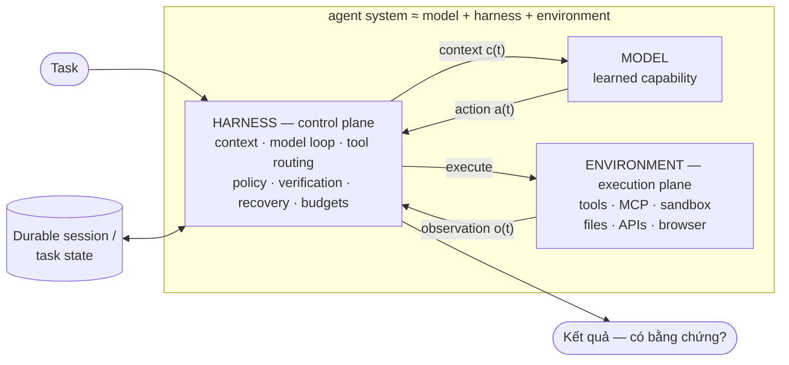

**🔑 Ý chính:** Model = năng lực; harness = cách nối năng lực vào công việc; environment = nơi công việc xảy ra. Thiếu harness, bạn có một chatbot — không phải một agent.

## 2 · Flow tổng — từ task đến "hoàn thành có bằng chứng"

Đây là toàn bộ vòng đời một agent làm việc, gộp mọi khái niệm của handbook vào một sơ đồ. Chú ý: vòng lặp **không** kết thúc khi model nói "xong" — nó kết thúc khi qua được **cổng verification**.

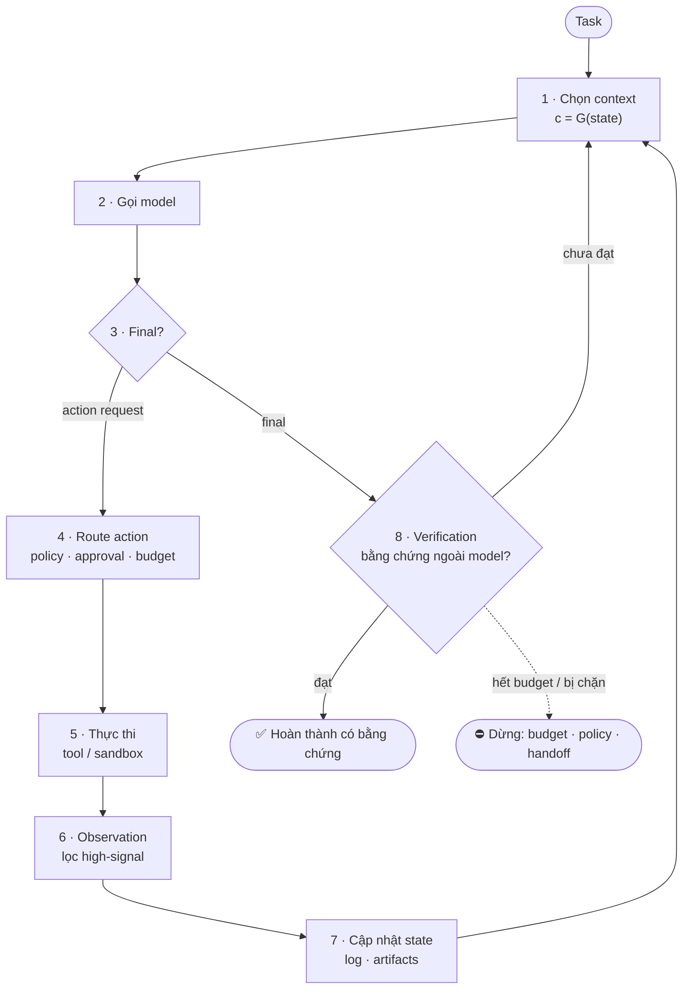

**🔑 Ý chính:** Hai mắt xích dễ bị bỏ qua nhất chính là chỗ tinh tế nhất: **(6)** kết quả thô phải được chuyển hoá thành observation tín hiệu cao, và **(8)** "xong" phải qua verification — self-report không phải bằng chứng. *(Mục 23–28)*

## 3 · Vòng lặp tối thiểu (chi tiết)

Phiên bản formal của sơ đồ trên — bốn đối tượng tiến hóa: state `s(t)`, context `c(t) = G(s(t))`, action `a(t) = M(c(t))`, observation `o(t) = E(a(t))`; state cập nhật `s(t+1) = U(s(t), a(t), o(t))`.

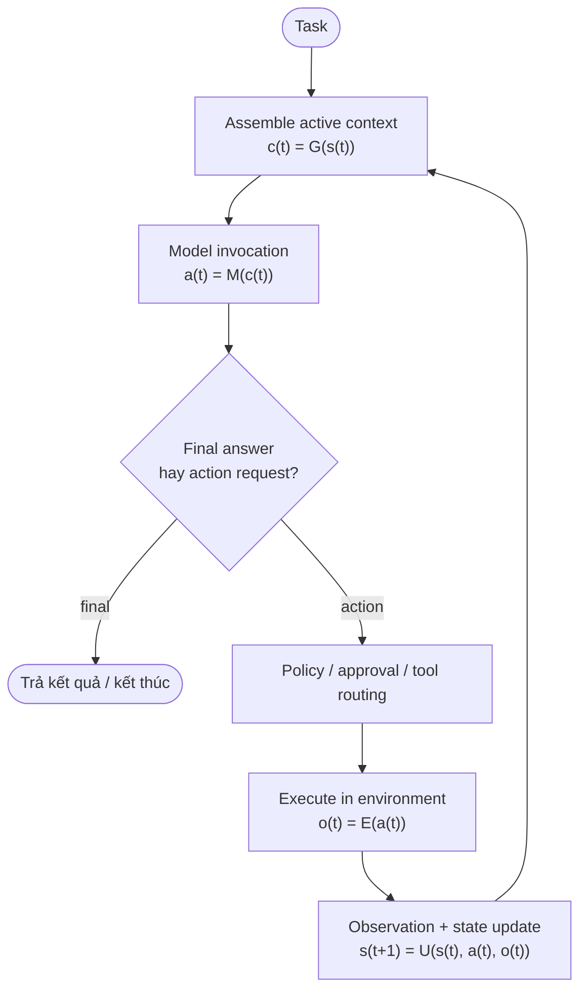

**🔑 Ý chính:** Tinh thần bền vững của vòng lặp — **act → observe → update → continue** — không cần expose "suy nghĩ riêng tư" của model; chỉ cần vòng lặp hành động–quan sát đúng. Đây là di sản của ReAct. *(Mục 2)*

## 4 · Harness thực sự làm gì

Nếu model là "bộ não", harness là toàn bộ phần còn lại của cơ thể. Cây dưới đây là bảng phân công trách nhiệm — dùng nó như checklist khi thiết kế hoặc debug hệ thống. *(Mục 3)*

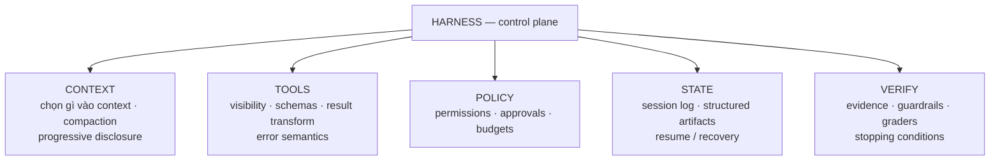

**🔑 Ý chính:** Mỗi nhánh là một câu hỏi thiết kế: *việc này ai làm? làm thế nào? khi fail thì sao? có quan sát được không?* Không harness nào sở hữu tất cả — nhưng chỗ nào trống, chỗ đó sẽ thành failure mode.

## 5 · Vòng đời một tool call

Chi tiết hóa bước 4–6 của flow tổng: một `tool call` đi qua policy, qua môi trường thực thi, rồi quay về model — dù thành công, bị chặn hay lỗi. *(Mục 10–11)*

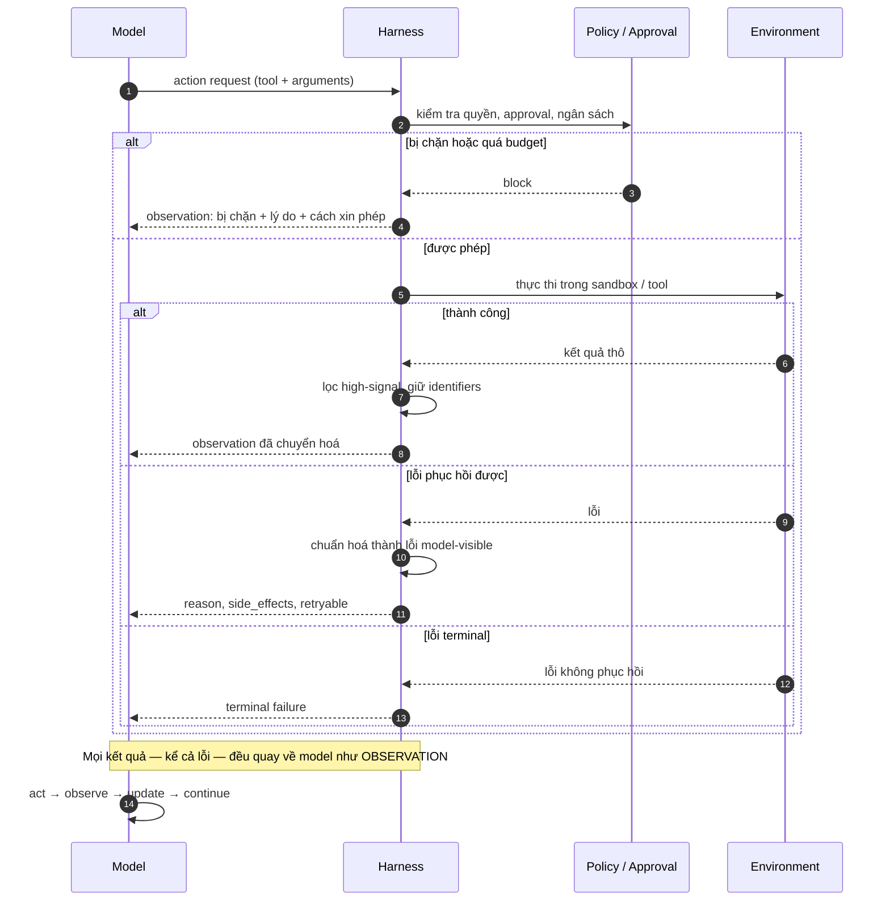

**🔑 Ý chính:** Lỗi không kết thúc cuộc chơi — lỗi là *thông tin*. Lỗi mù mờ kiểu `Error.` buộc model đoán; lỗi có cấu trúc (`reason · side_effects · retryable`) cho model đủ dữ kiện chọn bước tốt hơn.

## 6 · Thiết kế tool — giao diện ACI và 4 thuộc tính

Model không tương tác với "cái máy tính" — nó tương tác với một **giao diện cụ thể**. Cùng một repo, hai giao diện khác nhau tạo ra hai bài toán khác nhau cho model. Mọi tool nên được soi qua bốn câu hỏi: làm được gì (affordance) · gọi thế nào (contract) · trả về gì (observation) · bước tiếp có dễ hơn không (feedback). *(Mục 5–9)*

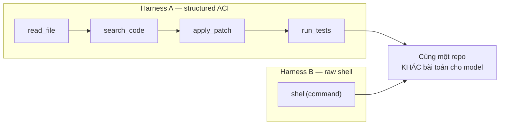

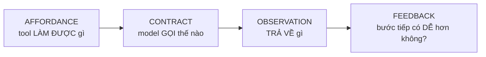

**🔑 Ý chính:** Tool không chỉ là code — tên, mô tả, schema và định dạng kết quả đều nằm **trong context của model**, nên thiết kế tool chính là thiết kế input. Cấu trúc giao diện là một phần của *độ khó hiệu dụng* của task. Thêm tool không tự động tốt hơn — mỗi tool thêm là một lựa chọn thêm có thể gây mơ hồ.

## 7 · Context — hai bề mặt state và sự mất mát của compaction

Durable state (session log, artifacts) và active context (những gì model thấy trong lượt này) là **hai bề mặt khác nhau**: có lưu ≠ được thấy; được thấy ≠ được lưu. Harness chạy hàm chọn `G` mỗi lượt — và compaction trong đó là phép biến đổi **có mất mát**: `C(H) ≠ H`. *(Mục 12–15)*

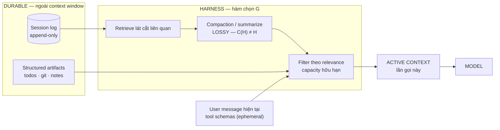

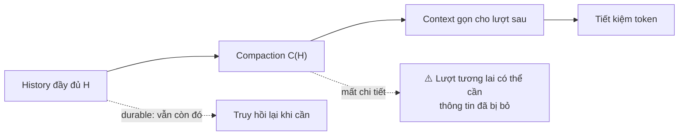

**🔑 Ý chính:** Nhồi mọi thứ vào context là sai (capacity hữu hạn + nội dung vô can cạnh tranh attention). Progressive disclosure: định hướng đủ dùng → để thông tin sâu *discoverable* → load chi tiết khi task cần. Và nhớ: compaction không phải xóa — chỉ là tóm tắt; gốc phải còn truy hồi được.

## 8 · An toàn — ba vùng tin cậy và lời dặn vs ranh giới

Nguyên tắc xương sống: **instruction không thay được ranh giới cấu trúc**. Credentials đứng *ngoài* sandbox (thứ không tồn tại trong sandbox thì không thể đọc từ sandbox). Egress allowlist là một *capability grant*, không chỉ là bộ lọc địa chỉ. Dữ liệu từ web/email/tool — dù trông như mệnh lệnh — vẫn là *dữ liệu*. *(Mục 18–22)*

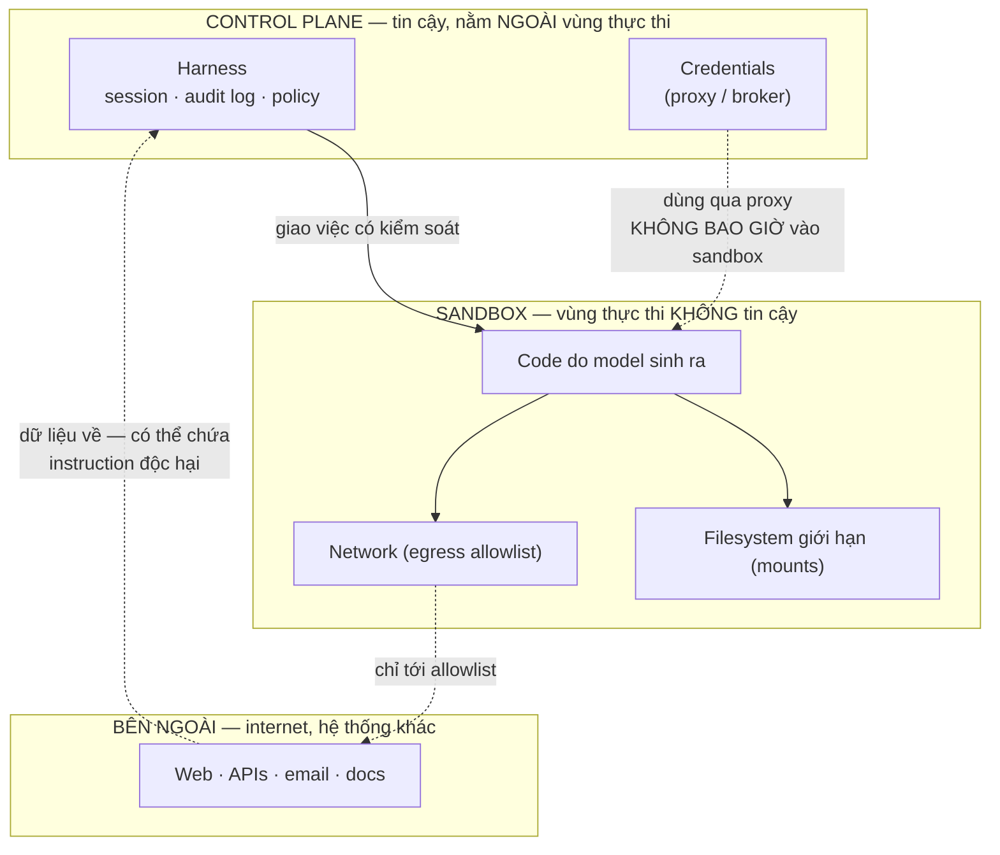

**🔑 Ý chính:** Ba vùng = ba mức tin cậy. Approval kiểm soát *quyết định*; containment kiểm soát *reachable capability* — chỉ containment mới đỡ được khi phán đoán của model bị lừa (red-team: 24/25 lần exfiltrate thành công qua prompt injection).

## 9 · Lỗi, retry và phục hồi

Không phải mọi lỗi đều được retry — và retry chỉ an toàn với operation idempotent. Với side effect không idempotent (charge tiền, gửi email, tạo order), phải **reconcile trước khi retry**: đọc lại trạng thái, dùng dedup record / idempotency key. Bốn trạng thái `requested → executed → observed → committed` không chuyển tiếp atomic. *(Mục 29–31)*

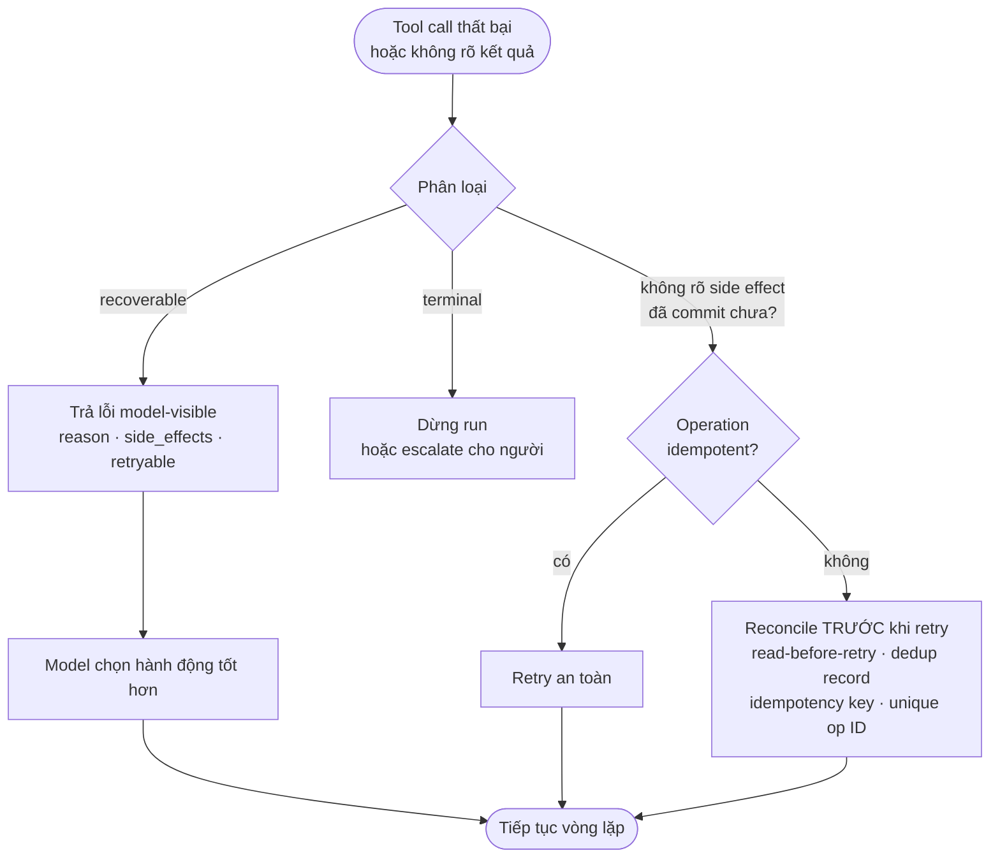

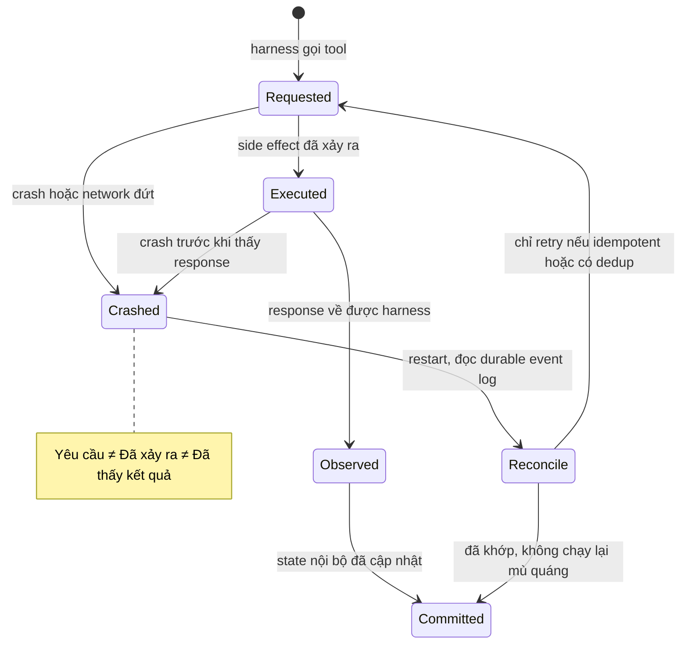

**🔑 Ý chính:** Automatic retry là **chính sách theo từng tool**, không phải chiến lược phục hồi phổ quát. "Tool fail thì cứ retry" là một trong những ngộ nhận đắt tiền nhất — với `charge_card`, nó là nhân đôi tiền.

## 10 · Kiểm chứng — "done" phải có bằng chứng

Model tuyên bố "đã xong" chỉ là **claim**. Cổng verification kiểm bằng thứ bên ngoài model: test deterministic (máy chấm) với thuộc tính máy kiểm được, evaluator độc lập hoặc con người với thuộc tính chủ quan. τ-bench là hình mẫu: so trạng thái database cuối với goal đã annotate, thay vì tin lời agent. *(Mục 25–28)*

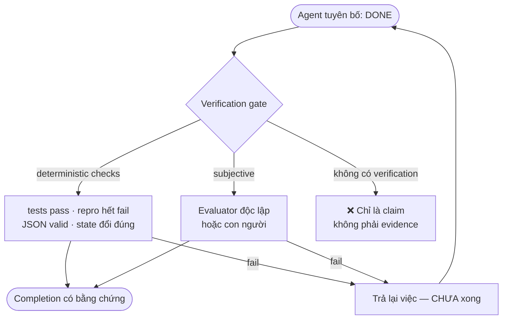

**🔑 Ý chính:** Nơi nào kiểm được bằng máy, đừng bắt model "nhớ luật" — hãy *ép* bằng cơ chế (structural test, linter, guardrail). The model should not have to remember a rule that the system can cheaply enforce.

## 11 · Chạy dài hạn — session, artifact, resume

Task chạy hàng giờ/ngày phải sống sót qua crash, mất worker, sandbox bị thu hồi, network đứt, user pause. Kiến trúc chuẩn: **durable session log** (append-only) nằm ngoài harness + **structured artifacts** (todo, notes, git) + khả năng **resume** — tiếp tục đúng chỗ dừng, không bắt đầu lại. *(Mục 17, 29)*

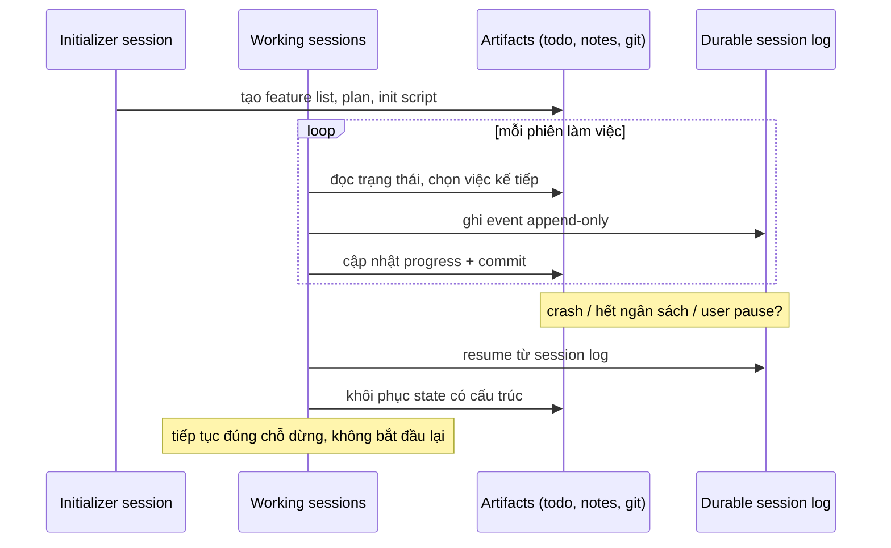

**🔑 Ý chính:** Chạy dài = bài toán systems cổ điển mặc áo mới: durability, recovery, consistency, retries, failure isolation. Đừng mong prompt giải được bài toán database.

## 12 · Subagents — khi nào nên và không nên

Delegation chỉ đáng giá khi công việc **tách được thành subtask độc lập**. Task tuần tự chặt thì coordination cost lấn át toàn bộ lợi ích — bằng chứng thực nghiệm: một cấu hình multi-agent tăng +80.9% trên bài finance nhưng **giảm 39–70%** trên bài tuần tự PlanCraft. *(Mục 32–33)*

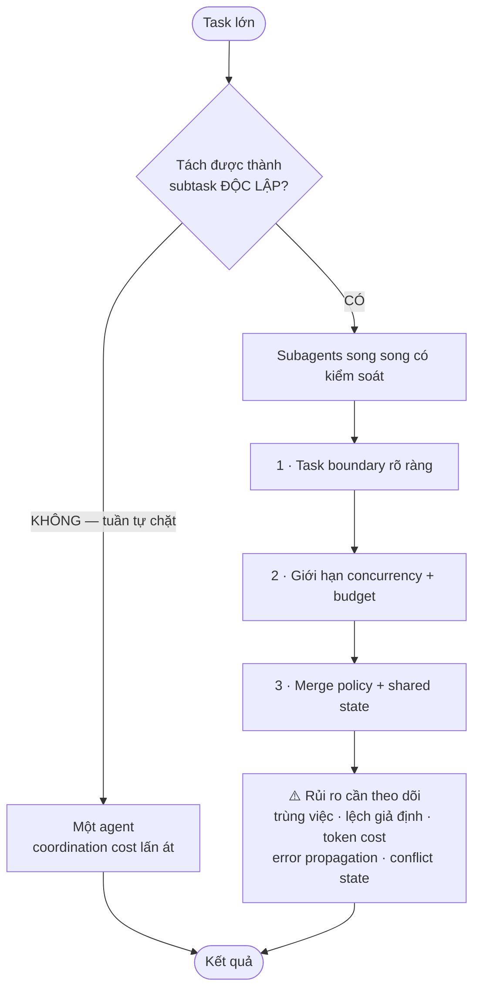

**🔑 Ý chính:** Delegation phải được biện minh bằng **cấu trúc task**, không bằng niềm tin "nhiều agent hơn là tốt hơn". Và subagent output cũng là một bề mặt tấn công — đừng mặc định nó "an toàn hơn" tool output.

## 13 · Giả định của harness có "hạn sử dụng"

Mỗi thành phần harness (workaround, scaffolding, evaluator, planner...) là **một giả thuyết về giới hạn hiện tại của model**. Khi model tiến bộ, giả thuyết phải được test lại — nếu không, harness tích tụ "dead weight": latency, token cost, complexity và failure mode mới. Ví dụ thật: cơ chế context-reset cần cho Sonnet 4.5 trở thành vô dụng với Opus 4.5; harness đầy đủ chạy 6 giờ/$200 so với solo 20 phút/$9 — tốt hơn nhưng đắt gấp >20 lần. *(Mục 39)*

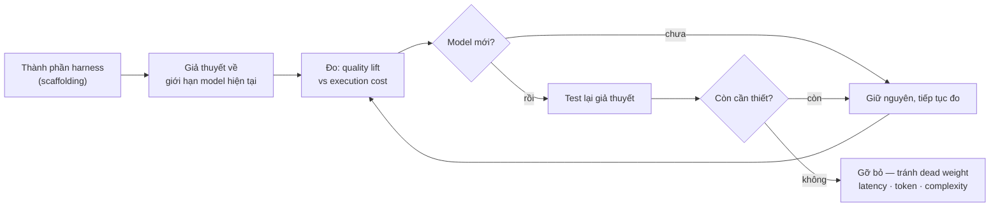

**🔑 Ý chính:** Đừng coi harness là bất biến. Khi model đổi, chạy lại phép đo — component nào không còn biện minh được *quality lift* so với *cost* thì gỡ.

## 14 · Bản đồ 13 failure modes

Khi hệ thống hỏng, hãy chẩn đoán theo bản đồ này thay vì đoán mò. Harness engineering phần lớn là việc biến các loại lỗi này thành thuộc tính **observable và testable**. *(Mục 40)*

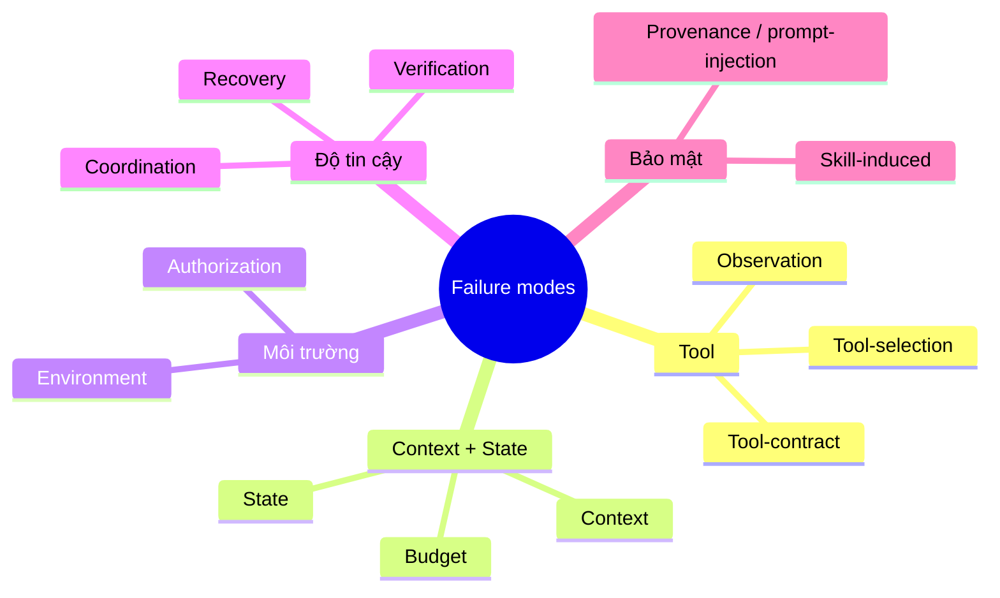

**🔑 Ý chính:** Mỗi loại lỗi cần: một tín hiệu quan sát được, một cách phân loại, và một cơ chế phản ứng (retry / escalate / dừng). Không có ba thứ đó thì lỗi chỉ là "hệ thống chạy sai gì đó".

## 15 · MCP — đặt đúng vị trí

MCP chuẩn hóa interface giữa ứng dụng AI và các capability (tools, resources, prompts). Nó là **lớp tương tác**, không phải kiến trúc agent. Tasks là extension tùy chọn (còn draft) cho async task handle. Mọi thứ thuộc về *điều khiển* — schedule loop, chọn context, đánh giá completion, approval, retry, sandbox, coordination, evaluation — vẫn thuộc về harness. *(Mục 11)*

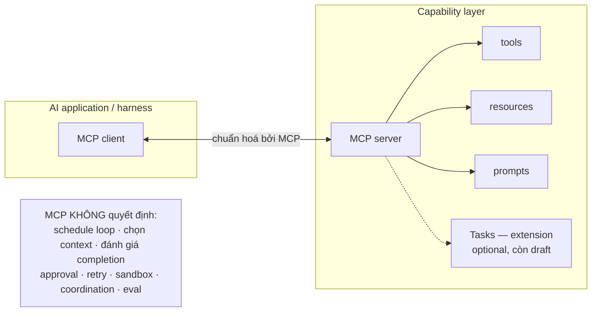

**🔑 Ý chính:** Safe mental model — **interoperable capability interface**, không phải *entire agent architecture*.

## 16 · Checklist chốt — 15 câu hỏi kiểm tra hệ thống

Khi đánh giá bất kỳ hệ agent nào, đi qua 15 câu này:

1. Model thực sự nhận được gì? — instructions, history, tool schemas, retrieved state, summaries, artifacts.
2. Ai điều khiển loop? — application code, managed harness, workflow engine, hay agent khác.
3. Những action nào available? — function tools, MCP tools, shell, browser, files, APIs, subagents.
4. Action thực thi ở đâu? — trusted process, local machine, container, VM, remote service.
5. Cái gì sống sót qua turn / crash? — session events, files, snapshots, external side effects.
6. Luật nào được ép bằng máy? — schemas, mounts, network boundaries, approvals, tests, budgets.
7. Errors biểu diễn thế nào? — fatal exception, retry, model-visible observation, human escalation.
8. Action nào an toàn để retry? — idempotent, deduplicated, hay không cả hai.
9. Agent lấy ground truth bằng cách nào? — tests, logs, browser state, database state, external responses.
10. Cái gì chứng minh completion? — model claim, deterministic validator, external state, evaluator, human.
11. Run dừng thế nào nếu mãi không thành công? — turn/time/token/tool/cost/policy budgets.
12. Sau gián đoạn thì sao? — resume, retry, reprovision, rollback, restart.
13. Observation không tin cậy có mang instruction được không? — web data, tool output, files, memory, loaded skills, subagent reports.
14. Subagents được coordinate thế nào? — task boundaries, shared state, merge policy, concurrency limits.
15. Harness được evaluate thế nào? — ablations, representative tasks, stable environments, outcome metrics.

**🔑 Ý chính:** *A system that cannot answer these questions may still work in a demo. It is much harder to reason about in production.*

## 17 · Bản đồ tài liệu

- **harness-engineering-course.html** — khóa học tương tác: 43 mục bài học, quiz tự chấm, flashcards, bảng tra.
- **design.md** — tài liệu này: sơ đồ Mermaid các flow chính (dành cho người đọc/soạn thảo Markdown).
- **design.html** — bản render của tài liệu này, mở trên trình duyệt là xem được ngay.
- **mermaid.min.js** — thư viện vẽ sơ đồ đi kèm (để design.html chạy offline; nếu thiếu, trang tự tải từ internet).

> Kết luận một dòng của cả bộ tài liệu: **Model cung cấp năng lực — harness quyết định năng lực đó được nối vào công việc như thế nào, và mọi mắt xích phải kiểm chứng được bằng bằng chứng ngoài model.**
